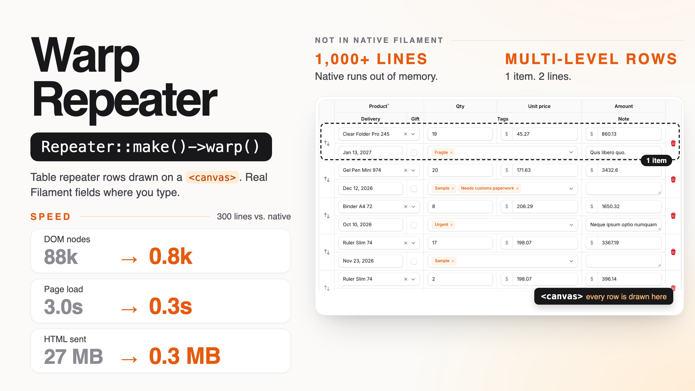

# Warp Repeater

**Fast Filament table repeaters for long forms: the rows of a `Repeater::table()` are drawn on a `<canvas>`, with a sticky header and ledger-style multi-level rows that the native repeater does not have, while every field still behaves exactly like Filament's own.**

<a href="https://demo.warpui.com/repeater"></a>

Edit line items, open the searchable selects and date pickers, reorder lines and compare with the native repeater side by side at **[demo.warpui.com/repeater](https://demo.warpui.com/repeater)**. No sign-up needed; the data is reset every hour.

A table repeater with a few hundred items gets slow, and with a thousand it may not render at all. Every item renders every field as Blade, and fields such as a `Select` repeat their whole option list in every row. The browser then has to parse megabytes of HTML and start thousands of Alpine components.

Warp Repeater keeps your existing `Repeater` definition. Add `->warp()` and the rows are drawn on a canvas. The header, the "Add" button, validation, actions and saving are still Filament's own. The row under the pointer and the row you are working in become real Filament fields, so typing, selecting, date pickers, dropdowns and the item actions are exactly the native ones.

```php
Repeater::make('items')
    ->table([...])
    ->schema([...])
    ->warp()
```

## Why

Measured on the demo's invoice form, whose line items have five fields, one of them a `Select` with 200 options (Chrome, Filament 5):

| | Native repeater | Warp Repeater |
| --- | --- | --- |
| 300 lines: HTML sent | 27 MB | 0.3 MB |
| 300 lines: DOM nodes | 88,175 | 809 |
| 300 lines: time to `load` | 3.0 s | 0.3 s |
| 300 lines: save | 4.3 s | 0.8 s |
| 1,000 lines | PHP runs out of memory (256 MB) | 0.6 MB, loads in 1.0 s |

On an order form with a `relationship()` repeater, a searchable select, a JavaScript date picker, a multiple select and `live()` totals, 300 lines go from 16.3 MB and 97,457 DOM nodes to 0.5 MB and 926 nodes, the page loads in 0.6 s instead of 1.8 s, and saving takes 1.3 s instead of 2.5 s.

## Features

- **Drop-in**: one method on the repeater you already have. Same schema, same `TableColumn` headers, same validation, actions and saving, including `relationship()` repeaters and `orderColumn()`.
- **Looks exactly like the native repeater.** The canvas draws what Filament renders: each field is rendered by Filament, measured in a hidden table with the same markup and CSS, and drawn from that. Compared pixel by pixel with the native repeater, in light and dark mode, on Chrome, Firefox and Safari.
- **Behaves like the native repeater**, because the rows you interact with are the native fields:
  - The row under the pointer and the focused row are real Filament fields. Clicking, typing, the caret, native selects, Filament's searchable select, the date picker panel, the clone, delete and move buttons all work as usual.
  - Tab and Shift+Tab move through the fields row by row, and in and out of the repeater, with each browser's own rules (Safari skips buttons by default, just like on the native repeater).
  - Values you type before saving are drawn from Livewire's state, so the canvas never shows stale data. `live()` fields and `afterStateUpdated()` hooks run as usual.
  - Validation errors appear under the fields, and the rows grow to fit them.
  - Drag-and-drop reordering, with Filament's own `reorder` action.
  - Narrow containers use Filament's stacked layout (each item as a card), like the native repeater.
- **Sticky header**: `->warpStickyHeader()` keeps the header row on screen while the page scrolls, so you always know which column you are typing in, even 500 lines down. The native repeater has no equivalent.
- **Validation errors**: saving scrolls to the first line with an error, like the native form. `->warpErrorNavigation()` adds "3 lines have errors" with previous and next buttons, and error markers along the table.
- **Multi-level rows**: show each item on several lines, ledger style, with a multi-level header. The native repeater has no equivalent.
- **Column summaries**: `->warpSummary()` on a field adds a summary row under its column (sum, average, min, max, count, checked), updated as you type.
- **Spreadsheet editing**: `->warpSpreadsheet()` adds Enter and arrow keys to move between lines, pasting tables from Excel or Google Sheets (adding lines as needed), range selection, copy, and fill down with Ctrl/Cmd+D.
- **Add lines from a list**: `RecordPicker` shows a list of your records (products, services…) beside the repeater or in a dialog. Drag a row onto the lines, or tick rows and add them, and each record becomes a line filled by your own code. The same product again raises the quantity of its line instead. Works with the native repeater too.
- **Unsaved changes**: `->warpChangeMarks()` marks the cells and lines changed since the last save, and counts changed, new and removed lines.
- **Search**: `->warpSearch()` adds a search field that finds text in every line, including the ones drawn on the canvas, which the browser's own find cannot see.
- **Sorting and filters**: `->warpSorting()` and `->warpFilters()` add a button to each column header to sort the lines and filter them by value, like a spreadsheet. Only what you see changes: the saved order and the hidden lines stay as they are.
- **Line numbers**: `->warpRowNumbers()` numbers the lines in a first column, so "line 214" in a validation message or a phone call is easy to find.
- **Fixed height**: `->warpHeight(480)` scrolls the lines inside the repeater, so the header, the summary row and the fields after the repeater stay in place.
- **Wide tables with frozen columns**: `->warpTableWidth(1800)->warpFrozenColumns(1)` scrolls tables with many columns horizontally while the first columns stay in view.
- **Theme aware**: colors, fonts, spacing and icons come from Filament's CSS, so custom themes and dark mode work without configuration.
- **Browser tests**: a small JavaScript API finds a field on the canvas to click (`cellPoint()`), reads the lines as shown (`rows()`) and waits until requests and drawing are done (`whenIdle()`), for Playwright and other browser tests.
- **Automatic fallback**: layouts other than `table()` and empty repeaters render the regular Filament repeater with no change on your side.

## Screenshots

Multi-level rows, two lines per item. The item under the pointer is made of real Filament fields, here with a multiple select open; the other items are drawn on the canvas:

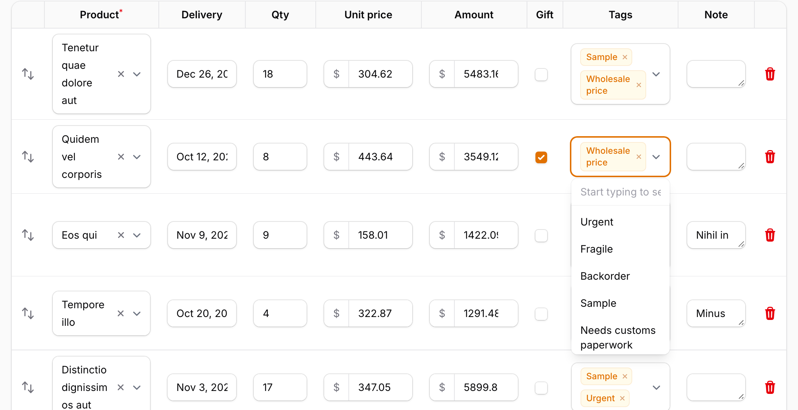

The same items without the pointer, all drawn on the canvas:

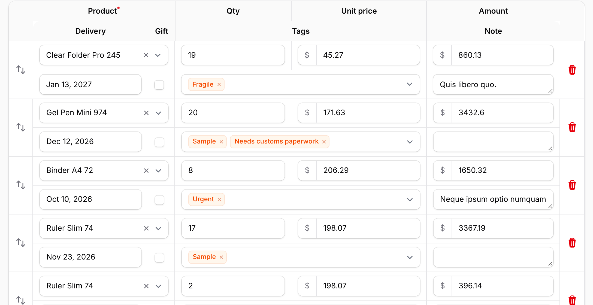

A sticky header that stays below the panel's topbar, 64 lines down:

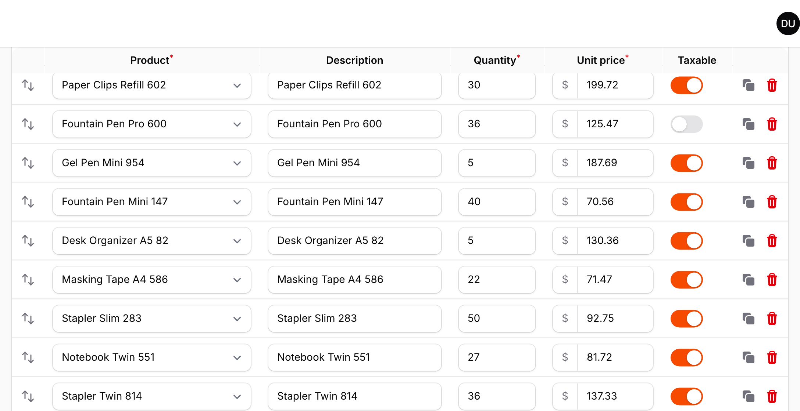

600 lines down an invoice with 1,000 lines:

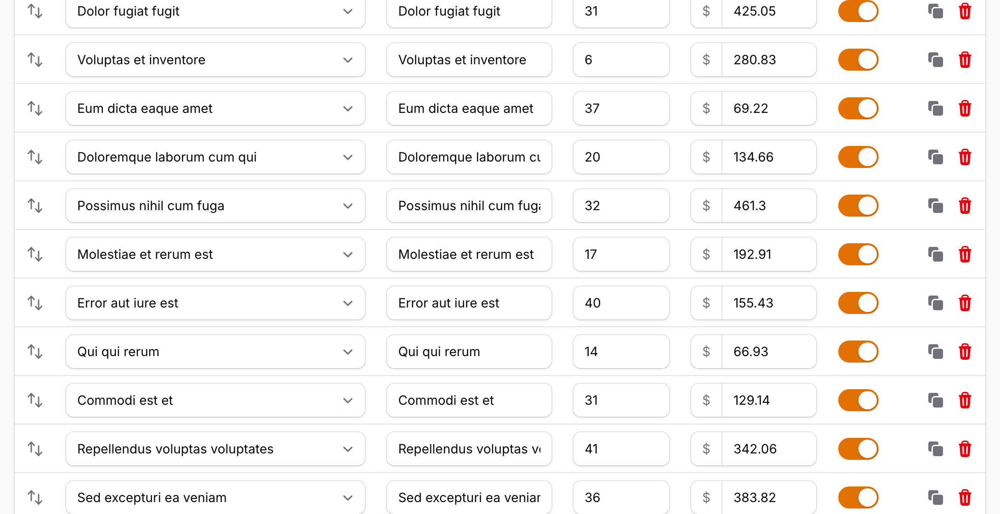

## Requirements

- PHP 8.3+
- Laravel 12 or 13
- Filament 5.8.3 or later (Livewire 4)

Works in panels and in standalone Livewire components that use Filament's form builder.

### Tested on

Before each release, the full test suite runs on PHP 8.3, 8.4 and 8.5 × Laravel 12 and 13 × SQLite, MySQL, MariaDB and PostgreSQL, with each database at its newest and its oldest supported version: 42 combinations in all. A version is released only when every combination passes.
[See the results for each release](https://github.com/qalainau-labs/filament-warp-repeater-docs/tree/main/test-runs).

## Installation

> **Warp Repeater is a commercial plugin.** A license is required. After purchase you receive credentials for the private Composer repository.

Add the repository and authenticate:

```bash
composer config repositories.qalainau composer https://qalainau.privato.pub/composer
composer config --auth http-basic.qalainau.privato.pub "your-email" "your-license-key"
```

The username is the email address on your license and the password is your license key. Use the same credentials on every machine and server that installs the package, such as your laptop, CI and production.

Install the package and publish Filament's assets:

```bash
composer require qalainau/filament-warp-repeater
php artisan filament:assets
```

The service provider is auto-discovered. There is nothing else to register.

> Run `php artisan filament:assets` again after every update of the package. The asset URLs contain a hash of the file contents, so browsers pick up the new build immediately.

### AI coding assistants (Laravel Boost)

Warp Repeater ships instructions for AI coding assistants such as Claude Code, Cursor and Codex. If your app uses
[Laravel Boost](https://laravel.com/docs/boost), the assistant learns how to use Warp Repeater from them: which options are built in (totals, pasting from Excel, search), what is easy to get wrong, and how to test a form with a warp repeater.

- **Guidelines** (`resources/boost/guidelines/core.md`): a short summary that Boost adds to `CLAUDE.md`,
  `AGENTS.md` and the other agent files. It also points the assistant to this README in `vendor/`, so it reads the
  documentation of the version you have installed instead of guessing.
- **Skill** `warp-repeater-development` (`resources/boost/skills/`): the steps for adding a warp repeater, the built-in options to use instead of custom code, and feature and browser tests. The assistant loads it when it works on a repeater.

Boost does not add guidelines of other vendors' packages on its own. When `php artisan boost:install` asks
"Which third-party AI guidelines/skills would you like to install?", select `qalainau/filament-warp-repeater`. To do
it without the question, add the package to `boost.json` and run the command again:

```json
{
    "packages": ["qalainau/filament-warp-repeater"]
}
```

```bash
php artisan boost:install --guidelines --skills -n
```

## Usage

Call `->warp()` on any repeater with a `table()` layout:

```php
use Filament\Forms\Components\DatePicker;
use Filament\Forms\Components\Repeater;
use Filament\Forms\Components\Repeater\TableColumn;
use Filament\Forms\Components\Select;
use Filament\Forms\Components\TextInput;
use Filament\Forms\Components\Toggle;
use Filament\Schemas\Components\Utilities\Get;
use Filament\Schemas\Components\Utilities\Set;

Repeater::make('lines')
    ->relationship()
    ->orderColumn('sort')
    ->table([
        TableColumn::make('Product')->markAsRequired(),
        TableColumn::make('Delivery'),
        TableColumn::make('Qty')->width('6rem'),
        TableColumn::make('Unit price')->width('9rem'),
        TableColumn::make('Taxable'),
    ])
    ->schema([
        Select::make('product_id')
            ->relationship('product', 'name')
            ->searchable()
            ->preload()
            ->required(),
        DatePicker::make('delivery_on')->native(false),
        TextInput::make('quantity')
            ->numeric()
            ->live(onBlur: true)
            ->afterStateUpdated(fn (Get $get, Set $set) => $set('amount', $get('quantity') * $get('unit_price'))),
        TextInput::make('unit_price')->numeric()->prefix('$'),
        Toggle::make('taxable'),
    ])
    ->warp();
```

`->warp()` accepts a boolean or a closure, so you can enable it conditionally:

```php
Repeater::make('lines')->warp(fn (): bool => auth()->user()->prefersFastForms());
```

`$repeater->isWarp()` tells you whether Warp Repeater is enabled for a repeater.

## Sticky header

```php
Repeater::make('lines')
    ->table([...])
    ->schema([...])
    ->warp()
    ->warpStickyHeader();
```

`warpStickyHeader()` keeps the header row below the panel's topbar while the page scrolls, until the last item scrolls past. Inside a modal or slide-over, the header sticks to the top of its scrolling area instead. Multi-level headers stick as a whole. It accepts a boolean or a closure and is off by default, like the native repeater, which has no sticky header.

## Validation errors

When saving shows validation errors, Filament scrolls to the first field with an error. Lines that are drawn on the canvas have no fields to scroll to, so Warp Repeater does it for them: it scrolls to the first line with an error, turns it into real fields, highlights it and focuses the field. This is always on, so the form behaves like the native one.

With hundreds of lines, finding the other errors is the hard part. `warpErrorNavigation()` helps with that:

```php
Repeater::make('lines')
    ->table([...])
    ->schema([...])
    ->warp()
    ->warpErrorNavigation();
```

- Above the repeater: "3 lines have errors", with buttons that jump to the previous and next line with errors, and the position ("2 of 3").
- On the right edge of the table: one marker per line with errors, placed relative to the whole repeater, like the markers on an editor's scrollbar. They stay in view while the repeater is on screen, and a click jumps to the line.
- Nothing is shown while there are no errors.

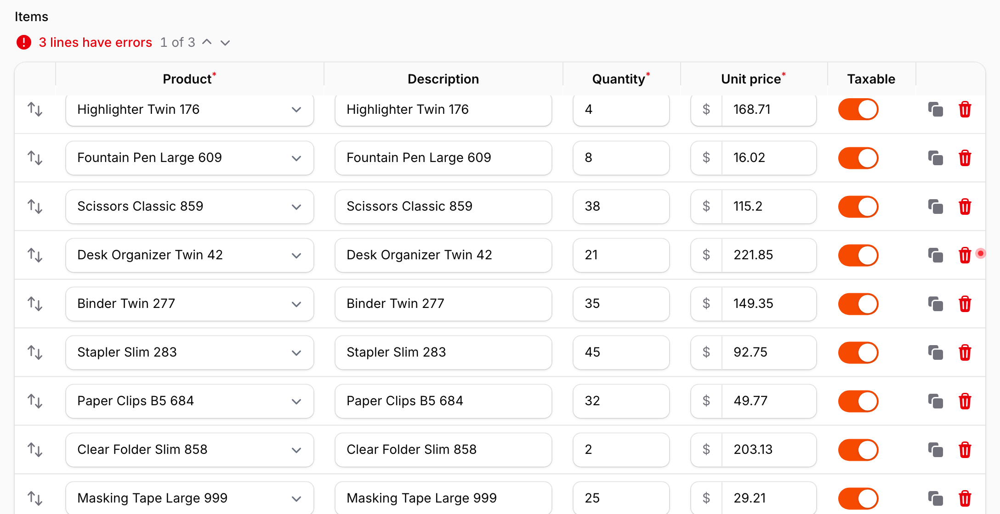

The labels come from the package's translations (English, Japanese, German, French, Spanish, Italian, Brazilian Portuguese, Korean and Chinese, simplified and traditional). To change them, publish the translations with `php artisan vendor:publish --tag=filament-warp-repeater-translations`.

## Multi-level rows

Items with many fields are easier to read when each item spans several lines, like a paper ledger. `warpMultiLevel()` lays the fields out on a grid: every item gets the same number of lines, and each field is placed on the grid with `warpCell()`.

```php
use Qalainau\FilamentWarpRepeater\MultiLevel\HeaderCell;

Repeater::make('lines')
    ->table([...])
    ->schema([
        Select::make('product_id')->warpCell(row: 1, col: 1, colSpan: 2),
        TextInput::make('quantity')->warpCell(row: 1, col: 3),
        TextInput::make('unit_price')->warpCell(row: 1, col: 4),
        DatePicker::make('delivery_on')->warpCell(row: 2, col: 1),
        Checkbox::make('gift_wrap')->warpCell(row: 2, col: 2),
        Textarea::make('note')->warpCell(row: 2, col: 3, colSpan: 2),
    ])
    ->warp()
    ->warpMultiLevel(columns: 4, rows: 2, header: [
        HeaderCell::make('Product')->row(1)->col(1)->colSpan(2)->markAsRequired(),
        HeaderCell::make('Qty')->row(1)->col(3),
        HeaderCell::make('Unit price')->row(1)->col(4),
        HeaderCell::make('Delivery')->row(2)->col(1),
        HeaderCell::make('Gift')->row(2)->col(2),
        HeaderCell::make('Note')->row(2)->col(3)->colSpan(2),
    ]);
```

- `warpCell(row, col, rowSpan, colSpan)` places a field (1-based). If you give only `row`, the field takes the first free place on that line. Fields without `warpCell()` fill the remaining free places line by line, like CSS Grid auto-placement. Extra lines are added when the grid is full.
- `header` is optional. Without it, each `TableColumn` header is shown at its field's position. `HeaderCell` supports `->alignment()`, `->markAsRequired()` and `->wrapHeader()`.
- `bordered: false` removes the lines between the columns of the grid. The lines between the lines of an item stay.
- The reorder handle and the item actions span the full height of the item.
- Tab moves through the fields line by line, then to the item actions.
- The column widths of the grid are computed from the content, the same way as in the regular layout.

Multi-level rows are a Warp Repeater layout. When Warp Repeater is disabled, when it falls back to the native repeater, and in narrow containers where Filament stacks each item as a card, the items are shown in the regular layout.

## Column summaries

Add `->warpSummary()` to a field in the repeater's schema to show a summary row under its column. The row is part of the table, below the last line, in the header's colors.

```php
use Qalainau\FilamentWarpRepeater\Summaries\Summary;

Repeater::make('lines')
    ->table([
        TableColumn::make('Product'),
        TableColumn::make('Quantity'),
        TableColumn::make('Unit price'),
        TableColumn::make('Taxable'),
    ])
    ->schema([
        Select::make('product_id')->options(...),
        TextInput::make('quantity')
            ->numeric()
            ->warpSummary(Summary::sum()->label('Total')),
        TextInput::make('unit_price')
            ->numeric()
            ->prefix('$')
            ->warpSummary([
                Summary::average()->prefix('$')->decimals(2),
                Summary::max()->prefix('$')->decimals(2),
            ]),
        Toggle::make('taxable')
            ->warpSummary(Summary::checked()),
    ])
    ->warp();
```

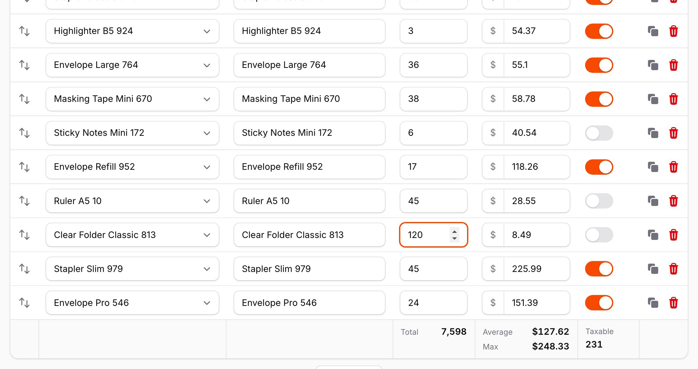

| Summary | Shows |
| --- | --- |
| `Summary::sum()` | The total of the numeric values. |
| `Summary::average()` | The average of the numeric values. Empty fields are not counted. |
| `Summary::min()`, `Summary::max()` | The lowest and highest numeric value. |
| `Summary::count()` | The number of lines with a value (not empty, not `false`, not an empty array). |
| `Summary::checked()` | The number of lines that are on (toggles, checkboxes). |

- `->label()` replaces the default label ("Sum", "Average", ...). Pass `''` to show the value alone.
- `->prefix()` and `->suffix()` are added around the value, for example a currency or a unit.
- `->decimals()` fixes the number of decimals. Without it, values show up to 2 decimals. Numbers are formatted for the page's language (`<html lang>`), with thousands separators.
- Pass an array to show several summaries in one column, one per line.
- Every option accepts a closure, evaluated like the field's own options.

The values are computed in the browser from the repeater's Livewire state, for all the lines, including the ones that are drawn on the canvas. They follow every change as you type, before anything is sent to the server, as well as lines that are added, cloned or deleted, and values set by `live()` fields and `afterStateUpdated()`. Values like `"1,250.50"` are read as numbers, and fields that are not numbers are skipped by sum, average, min and max.

With multi-level rows, each summary is placed under its field, at the same position on the grid, and footer lines without any summary are left out. In narrow containers, where Filament stacks each item as a card, the summary row lists each summarized column by name with its values.

The summary row is a Warp Repeater feature. When Warp Repeater is disabled or falls back to the native repeater, `warpSummary()` has no effect.

Summaries are for display only. They are not part of the form's state, so they are not sent with the form and not saved. If you need a total in the database, for example an `invoices.total` column for reports, compute it on the server from the saved lines. The lines of a `relationship()` repeater are saved after the record, so they are not in the `$data` of `mutateFormDataBeforeSave()`; use the page's `afterSave()` and `afterCreate()`, or a model event of the line model:

```php
// EditInvoice (and afterCreate() in CreateInvoice)
protected function afterSave(): void
{
    $this->record->update([
        'total' => $this->record->lines()->sum(DB::raw('quantity * unit_price')),
    ]);
}
```

Computing the total in a hidden field of the form is not enough: deleting a line runs only the repeater's hooks, and the value comes from the browser.

## Spreadsheet editing

Line items often come from a spreadsheet, and long tables are faster to fill with the keyboard. `warpSpreadsheet()` adds the keys people expect from Excel and Google Sheets:

```php
Repeater::make('lines')
    ->table([...])
    ->schema([...])
    ->warp()
    ->warpSpreadsheet();
```

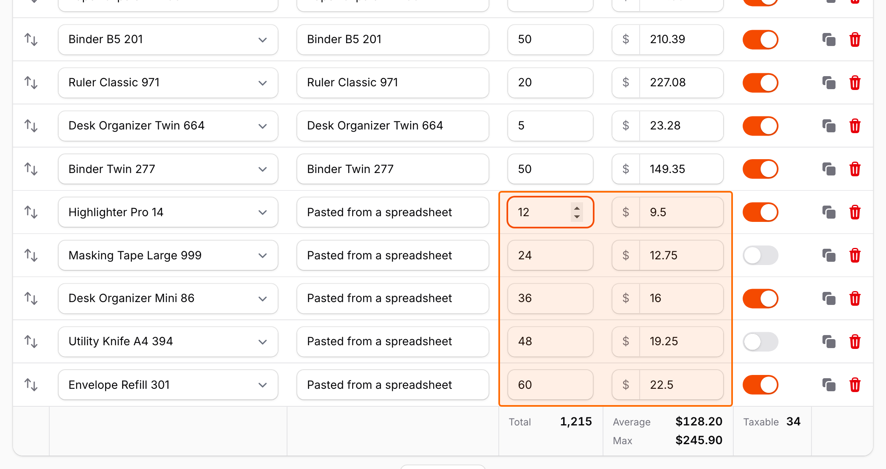

| Keys | In a text or number field |
| --- | --- |
| Enter / Shift+Enter | Move to the same column on the next / previous line. |
| ↓ / ↑ | Same as Enter / Shift+Enter. |
| Shift+click, Shift+↓ / Shift+↑ | Select a range of cells, from the focused field. |
| Ctrl/Cmd+C | With a range selected: copy it as tab-separated text, ready to paste into a spreadsheet. |
| Ctrl/Cmd+V | Paste cells copied from a spreadsheet (see below). |
| Ctrl/Cmd+D | With a range selected: copy the values of its first line to the other lines. |
| Escape | Clear the range. |

Tab and Shift+Tab still move between fields, and the arrow keys inside dropdowns, date pickers and select search fields keep working as usual.

**Pasting.** Copy cells in Excel, Numbers or Google Sheets and paste them into any field of the repeater. The values fill the fields to the right and below, and lines are added at the end when there are not enough of them, up to `maxItems()` and at most 1,000 lines per paste. To paste one value into many cells, select a range and paste. Each value is turned into the field's state:

- Selects accept the option's key or its label (any case). Multiple selects take a comma-separated list. Values that are not an option are skipped, and the old value stays.
- A searchable `relationship()` select also accepts the exact value of one of its search columns, so with `->searchable(['name', 'sku'])` a column of SKUs copied from a spreadsheet picks the products. The value must belong to exactly one record among the select's search results (the same query, tenant and `modifyQueryUsing()` as the select). Columns of other relationships (`customer.name`) and JSON columns are not compared.
- Toggles and checkboxes are on for `TRUE`, `1`, `yes`, `y`, `on`, `x` or `✓`, and off for anything else.
- Numeric text inputs drop thousands separators, currency symbols and units: `$1,250.50` becomes `1250.50`.
- Date pickers read any date that PHP can parse, as a time in the field's timezone (the time the user sees, also with `timezone()` or `FilamentTimezone::set()`), and store it the same way the date picker does.
- Disabled, read-only and hidden fields are skipped.
- `afterStateUpdated()` runs for every pasted field, so a field that looks up a price or fills other fields works as when it is typed. The repeater's own `afterStateUpdated()` (and its parents') runs once per paste. Pasting 400 lines into a field whose hook runs two queries takes about 2.5 seconds on the server.

Copying a range works the other way: selects are copied as their labels and toggles as `TRUE` / `FALSE`, so the cells paste back as they were.

Pasting and filling down run on the server, as a single Filament action on the repeater. The action is only available while `warpSpreadsheet()` is on and the repeater is not disabled, and it only writes to fields the user could type into. New lines are added the same way as with the "Add" button, so default values apply, and every changed field runs its `afterStateUpdated()` hooks, so `live()` totals are recalculated. Nothing is saved until the form is saved.

Notes:

- Enter no longer submits the form from a field in the repeater, and ↑ / ↓ no longer step the value of number fields.
- Filament's `DeleteAction` uses Ctrl/Cmd+D as its keyboard shortcut. While a range is selected in the repeater, Ctrl/Cmd+D fills down instead. Without a range, the shortcut is left to Filament.
- The repeater's items are filled in order, with columns counted in the order of the schema, the same as `table()` columns.

## Add lines from a list

Order and quote forms are filled from a catalog. `RecordPicker` is a schema component that lists the records of a query
you write, next to the repeater. Drag a row onto the lines, or tick several rows and press “Add ticked rows”: each record
becomes a new line, with the values your `fillUsing()` returns. When the product is already in the lines, its quantity
goes up by one instead.

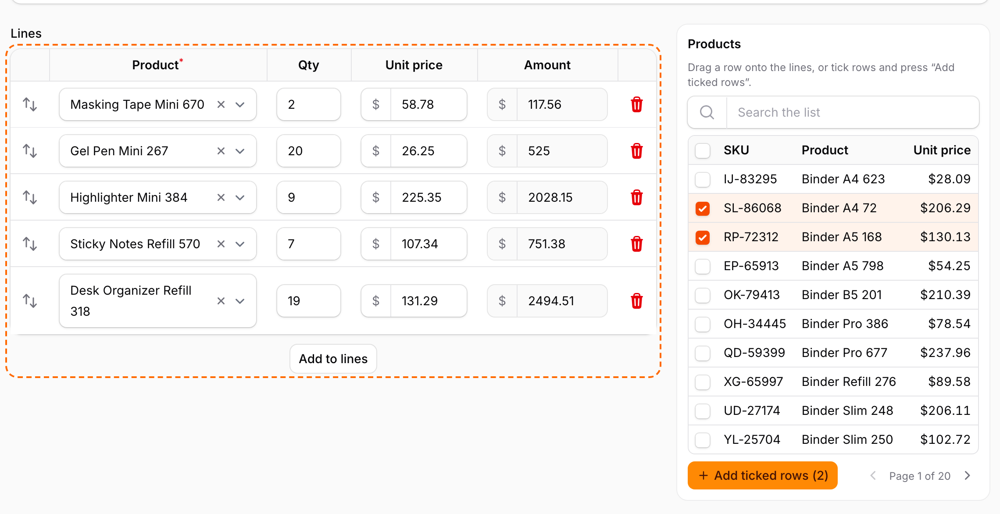

```php
use App\Models\Product;
use Filament\Forms\Components\Repeater;
use Filament\Schemas\Components\Grid;
use Illuminate\Support\Number;
use Qalainau\FilamentWarpRepeater\Picker\PickerColumn;
use Qalainau\FilamentWarpRepeater\Picker\RecordPicker;

Grid::make(['default' => 1, 'lg' => 3])->schema([
    Repeater::make('lines')
        ->relationship()
        ->table([...])
        ->schema([...])   // product_id, quantity, unit_price, amount
        ->warp()
        ->columnSpan(['default' => 1, 'lg' => 2]),

    RecordPicker::make('product_list')
        ->repeater('lines')
        ->heading('Products')
        ->query(fn () => Product::query()->where('is_active', true)->orderBy('name'))
        ->tableColumns([
            'sku' => 'SKU',
            'name' => 'Name',
            PickerColumn::make('price')
                ->label('Price')
                ->alignEnd()
                ->formatStateUsing(fn ($state): string => Number::currency($state, 'USD')),
        ])
        ->searchable(['sku', 'name'])
        ->fillUsing(fn (Product $record): array => [
            'product_id' => $record->getKey(),
            'quantity' => 1,
            'unit_price' => $record->price,
        ])
        ->mergeDuplicates('product_id', increment: 'quantity'),
]),
```

To keep the form narrow, open the list in a dialog from a button instead (put the picker above the repeater):

```php
RecordPicker::make('product_list')
    ->repeater('lines')
    ->modal()
    ->modalButtonLabel('Add products')
    // ...
```

| Method | What it does |
| --- | --- |
| `repeater('lines')` | The repeater to add lines to, by name. It must be in the same form (in a `Grid`, `Section` or any layout). Required. |
| `query(fn () => ...)` | The records the list shows **and the only records that can be added**. Return an Eloquent query; scope it to the user and tenant here (see below). Required. |
| `tableColumns([...])` | The columns of the list: `'attribute' => 'Label'`, or `PickerColumn::make('attribute')` with `label()`, `alignEnd()` (numbers) and `formatStateUsing(fn ($state, $record) => ...)`. Dot notation reads a relationship (`'category.name'`). Values are shown as text. |
| `fillUsing(fn (Model $record): array => [...])` | The values of the new line, by field name. They are set in the order you write them, like typing: each field's `afterStateUpdated()` runs, so a field that computes an amount works as usual. Names without a field are ignored. The line gets the repeater's default values first. |
| `mergeDuplicates('product_id', increment: 'quantity', by: 1)` | When a line already has the same `product_id` as the new one, add `by` to its `quantity` instead of adding a line (its `afterStateUpdated()` runs). With `increment: null`, the record is skipped. Without this method, every record adds a line. |
| `searchable(['sku', 'name'])` | Adds a search field. The text is searched with `LIKE` in these columns. Pass a closure `fn (Builder $query, string $search) => ...` for your own search. |
| `perPage(10)` | Rows per page of the list (at most 100). |
| `modal()` | A button that opens the list in a dialog instead of showing it in the form. In the dialog, rows are ticked, not dragged. `modalButtonLabel()` changes the button. |
| `heading()`, `addActionLabel()`, `height(480)` | The list's heading, the label of the “Add ticked rows” button, and a maximum height for the list (it scrolls inside). |
| `draggable(false)` | Ticking only, no dragging. |
| `authorizeUsing(fn (Model $record): bool => ...)` | An extra check for each record, for example a policy. Records that fail it are skipped. |

How it behaves:

- **Dragging** a row adds that record. If the row is ticked, dragging it adds every ticked row. The repeater gets a dashed
  outline while a row is over it. Dragging needs a mouse or a trackpad: phones and tablets do not send drag events, so
  the hint above the list only mentions ticking there.
- **Nothing is saved until the form is saved.** The picker changes the repeater's state only, the same way as the
  repeater's own “Add” button, and the form saves the lines as usual (including `relationship()` repeaters).
  `maxItems()` and `addable(false)` are respected.
- A short message above the list says what happened (“Added 2 lines.”, “1 line was already there, so its quantity went
  up.”), because new lines are added at the end of the repeater, which is often below the screen.
- It works with any table repeater, with or without `->warp()`, and in standalone Livewire forms as well as panels.
- The list stays in view while the page scrolls (it sticks under the top bar). In a narrow column, give the repeater a
  width with `warpTableWidth()` so that it scrolls inside its column instead of covering the list.

Security: the browser only sends the keys of the records to add. The server reads them again with your `query()`
(plus `authorizeUsing()`), so a key outside the query, of another tenant, or of a record that does not exist adds
nothing. At most 100 records are added per call, and keys that do not have the shape of the model's key (a number, or
a UUID or ULID with `HasUuids` / `HasUlids`) are ignored before the query runs. When the picker is hidden or disabled,
or the repeater is hidden or disabled, the server adds nothing. Keep authorization in `query()`: hiding a column does
not hide a record.

## Unsaved changes

In a long table it is easy to lose track of what you have changed. `warpChangeMarks()` marks it until the form is saved:

```php
Repeater::make('lines')
    ->table([...])
    ->schema([...])
    ->warp()
    ->warpChangeMarks();
```

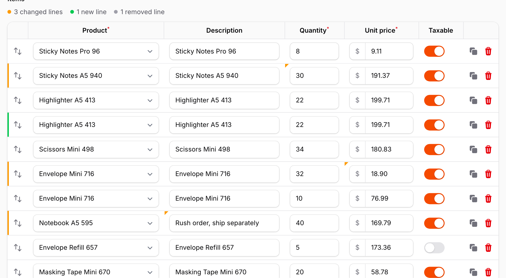

- A changed cell gets a small triangle in its top-left corner, and its line a bar on the left edge (warning color).
- A new line, added with "Add", cloned or pasted, gets a bar in the success color.
- Above the repeater: "3 changed lines", "1 new line", "2 removed lines". Click "changed" or "new" to jump to those lines one after another.
- Changing a value back to what it was removes the mark. Values are compared as the form would save them, so `23` and `"23"`, an empty string and `null`, a toggle's `1` and `true`, or the selected options `[1, 2]` and `["1", "2"]` are the same.

The marks compare each line with its values when the repeater was first shown, and follow every change as you type, before anything is sent to the server. When the form is saved, the saved values become the new reference. A save is a Livewire call to one of the `resetOn` methods: by default `save` (edit pages) and `create` (create pages). Pass your own method names if your form saves differently:

```php
->warpChangeMarks(resetOn: ['save', 'saveDraft'])
```

When does a call count as a save?

- On the create and edit pages of a Filament resource, `save` and `create` count only when the record was actually saved. Filament reports that with its `RecordSaved` event. If saving fails with validation errors, or a hook such as `beforeSave()` stops it with `$this->halt()`, the marks stay.
- Your own `resetOn` methods, and forms outside resource pages, count when the call ends without validation errors.
- Values you type while the save request is on its way are not part of that save, so they keep their marks.
- A save from a Filament action's closure counts when the record was saved through the page's `save()` or `create()`, or when the action calls `WarpRepeater::markSaved()` (see below).

**Saving from a Filament action.** When a button is a Filament action whose closure saves the form, the Livewire call is `mountAction` (or `callMountedAction` after a modal), not a method you can list in `resetOn`. On resource pages, calling the page's `save()` or `create()` in the closure is enough: the marks are cleared when the record was saved. If the action saves another way, tell the repeater with `WarpRepeater::markSaved()` after saving:

```php
use Filament\Actions\Action;
use Qalainau\FilamentWarpRepeater\WarpRepeater;

// on an edit page: saved through save(), nothing else to do
Action::make('saveDraft')->action(function (): void {
    $this->isDraft = true;
    $this->save();
});

// saved without save()
Action::make('saveDraft')->action(function (): void {
    $this->record->update([...$this->form->getState(), 'is_draft' => true]);
    $this->form->saveRelationships();
    WarpRepeater::markSaved($this);
});
```

`markSaved()` works on any Livewire page. A response with validation errors never clears the marks.

When the form is filled again, for example by a header action that reloads the record with `fillForm()` or `refreshFormData()`, the new values become the reference. Filament gives the items new keys on every fill, so without this every line would show as removed and added again.

The reference values live in the browser. Reloading the page starts again from the saved values, the same as the form itself. They are kept when the repeater is briefly empty and shows the native "Add" button, so deleting the last line and adding a new one shows one removed and one new line.

## Search

The browser's find (Ctrl/Cmd+F) only sees text in the page, and the lines that are drawn on the canvas are not text. `warpSearch()` adds a search field above the repeater that looks through every line:

```php
Repeater::make('lines')
    ->table([...])
    ->schema([...])
    ->warp()
    ->warpSearch();
```

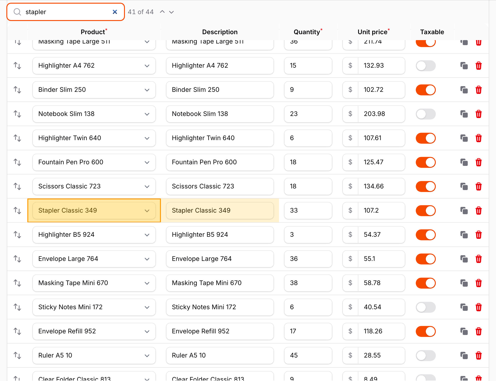

- Matching cells are highlighted, and the current match is outlined and scrolled into view. The position ("2 of 14") is shown inside the field, at its right end.
- Enter and Shift+Enter, or the arrow buttons right after the field, move to the next and previous match ("Next match" and "Previous match" show when you point at them). The buttons are disabled until something matches. Escape clears the search.
- Ctrl/Cmd+F while the focus is in the repeater moves to the search field. Elsewhere on the page it opens the browser's find as usual.
- The search looks at what the cells show: option labels for selects, the displayed date for date pickers, and the text of inputs. Case and accents are ignored (`zebra` finds `Zébra`). Toggles, checkboxes and password fields are not searched.
- The matches follow the values as you type, paste, add or delete lines.

With `warpStickyHeader()`, the search field and the other tools above the repeater stay on screen together with the header row.

## Sorting and filters

`warpSorting()` sorts the lines from the column headers, and `warpFilters()` filters them by value, like the filter buttons of a spreadsheet. Both change only what you see: the order in which the items are saved (`orderColumn()`) does not change, and hidden lines keep their values and are saved with the form.

```php
Repeater::make('lines')
    ->table([...])
    ->schema([...])
    ->warp()
    ->warpSorting()                        // every column
    ->warpFilters(['product_id', 'tags']); // or only these fields
```

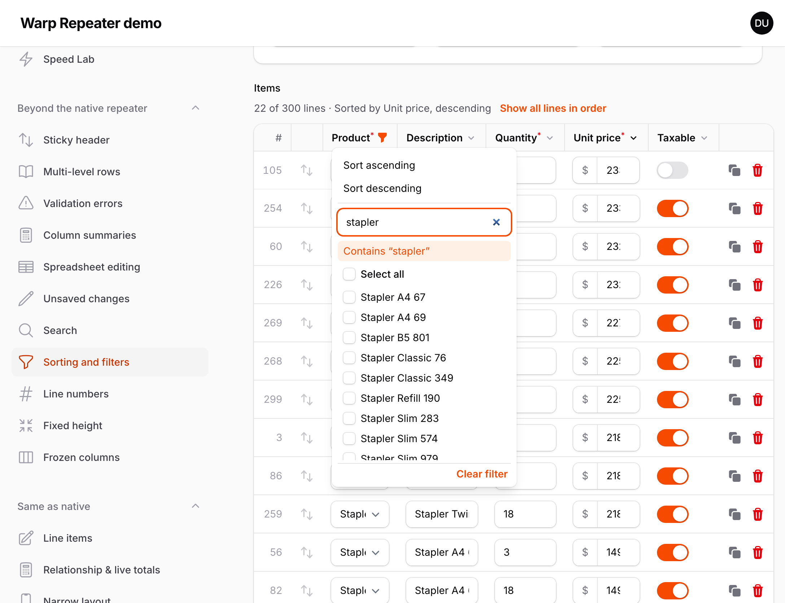

300 lines filtered to the 22 that contain "stapler", sorted by unit price. The line numbers keep the saved position, and drag and drop is off until "Show all lines in order":

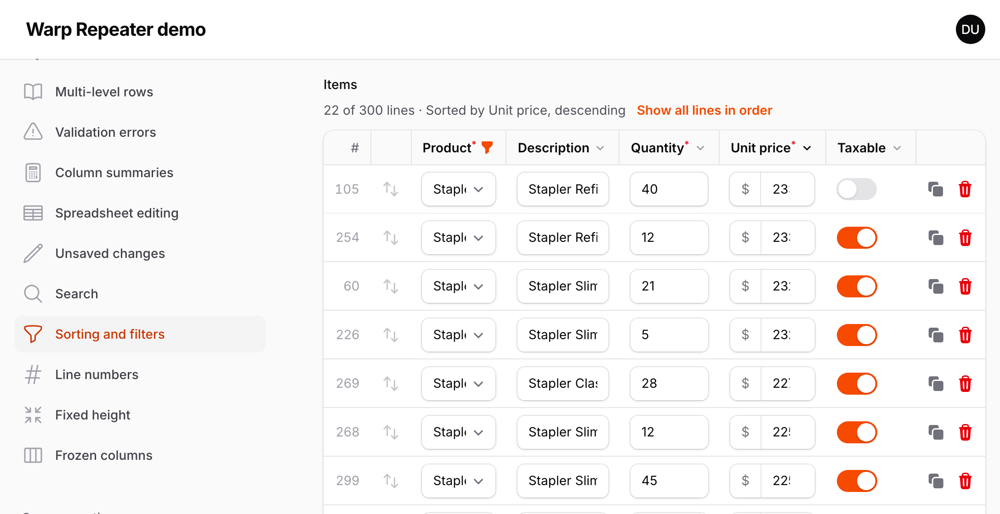

- Each sortable or filterable header gets one button, with the same chevron as Filament's sortable table columns, so the column widths hardly change. For a column you can only sort, the button switches between ascending, descending and the saved order. For a column you can filter, it opens a panel with "Sort ascending", "Sort descending" and the values of the column.
- The panel lists the values as they are shown: option labels for selects (each tag of a multiple select), the displayed date for JavaScript date pickers, and On / Off for toggles and checkboxes. Uncheck values to hide their lines, type to find a value, or press Enter to show the lines that contain the text. A line with several values (a multiple select) is shown as long as one of them is checked.
- Numbers sort by value, dates by date, and everything else by the shown text, in the page's language. Empty cells go last in both directions.
- The order and the filter are decided when you choose them, like in a spreadsheet: lines do not move or disappear while you type. Lines you add, clone or paste are shown, and so are lines with validation errors, even when they do not match the filter. When the form is filled again (a header action that reloads the record), the order and the filter are applied again to the new values. An open filter panel lists the values as of the last update.
- Above the repeater, "10 of 120 lines" and the sorted column are shown, with "Show all lines in order" to go back.
- While the lines are sorted or filtered, reordering by drag and drop and the move up and down buttons are off, because the order on screen is not the saved order. Pasting a table and filling down with `warpSpreadsheet()` fill the shown lines, in the order they are shown.
- Line numbers (`warpRowNumbers()`) keep the saved position, the column summaries (`warpSummary()`) still total every line, and the search (`warpSearch()`) looks at the shown lines.
- Password fields are never sorted or filtered. In narrow containers, where Filament stacks each item as a card, the headers are hidden; an order or filter chosen before stays, and "Show all lines in order" is still above the repeater.
- Both options accept a closure. The native repeater has no equivalent.

## Line numbers

`warpRowNumbers()` adds a column with the number of each line, before the reorder handle:

```php
Repeater::make('lines')
    ->table([...])
    ->schema([...])
    ->warp()
    ->warpRowNumbers();
```

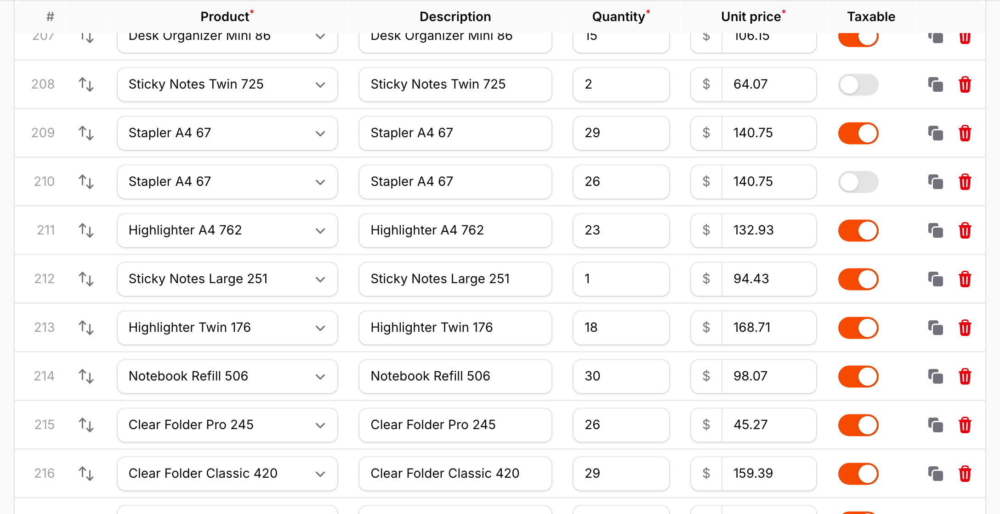

- The numbers are the position in the repeater, starting at 1. They follow the order as you reorder, add, clone or delete lines.
- They are not part of the form's state and are not saved.
- The header shows `#`, with "Line number" for screen readers (translatable).
- With multi-level rows, the number spans all the lines of an item. In narrow containers, where Filament stacks each item as a card, it is shown as `#12` at the top of the card.
- The column is as wide as the largest number, measured in the same way as the other columns.

## Fixed height

By default the repeater is as tall as its lines, and the page scrolls. `warpHeight()` gives the lines a fixed height and scrolls them inside the repeater instead, like a spreadsheet:

```php
Repeater::make('lines')
    ->table([...])
    ->schema([...])
    ->warp()
    ->warpHeight(480);      // pixels, or any CSS length: '60vh', '30rem'
```

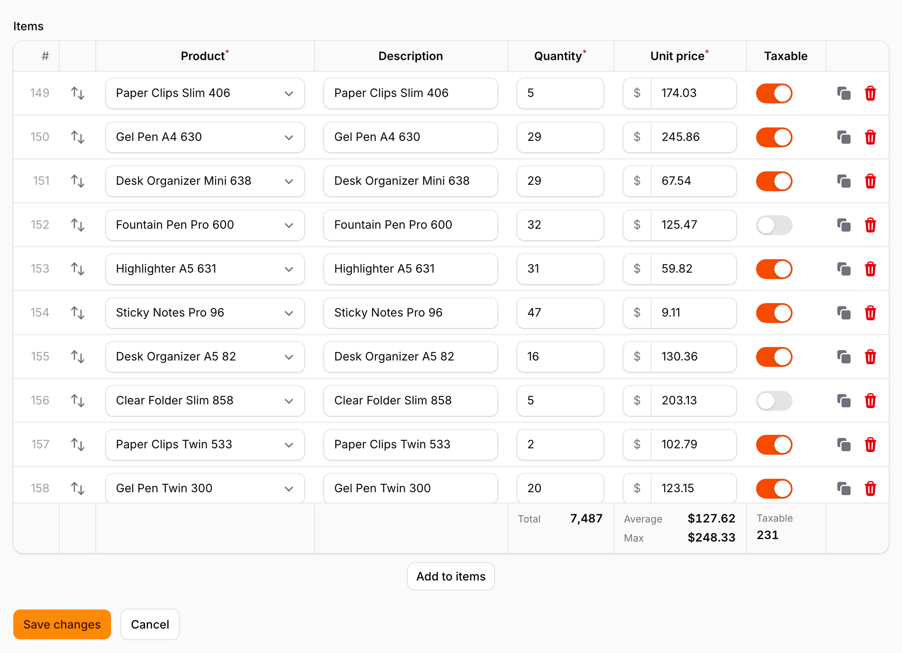

- Only the lines scroll. The header row, the summary row (`warpSummary()`), the "Add" button and the rest of the form stay where they are, so the fields after a 1,000-line repeater are one scroll away.
- When the lines are shorter than the height, the repeater is just as tall as its lines.
- Everything that moves to a line scrolls inside the repeater first, then the page if needed: saving with validation errors, the error navigation, search, Enter and the arrow keys of `warpSpreadsheet()`.
- The scroll position stays when Livewire updates the form.
- With narrow containers (Filament's stacked layout), the cards scroll inside the same height.

With classic scrollbars (Windows, or macOS set to always show scrollbars), the scrollbar is drawn over the right edge of the last column, which is usually the item actions. It is a thin scrollbar where the browser supports `scrollbar-width`.

## Wide tables and frozen columns

A repeater with many columns squeezes every field into the width of the form. `warpTableWidth()` gives the table a minimum width and scrolls it horizontally when the form is narrower. `warpFrozenColumns()` keeps the first columns in view while you scroll, like frozen columns in a spreadsheet:

```php
Repeater::make('lines')
    ->table([
        TableColumn::make('Product'),
        TableColumn::make('SKU'),
        TableColumn::make('Quantity'),
        // ... ten more columns
    ])
    ->schema([...])
    ->warp()
    ->warpTableWidth(1800)      // pixels, or any CSS length: '120rem'
    ->warpFrozenColumns(1);     // the first column (Product) stays in view
```

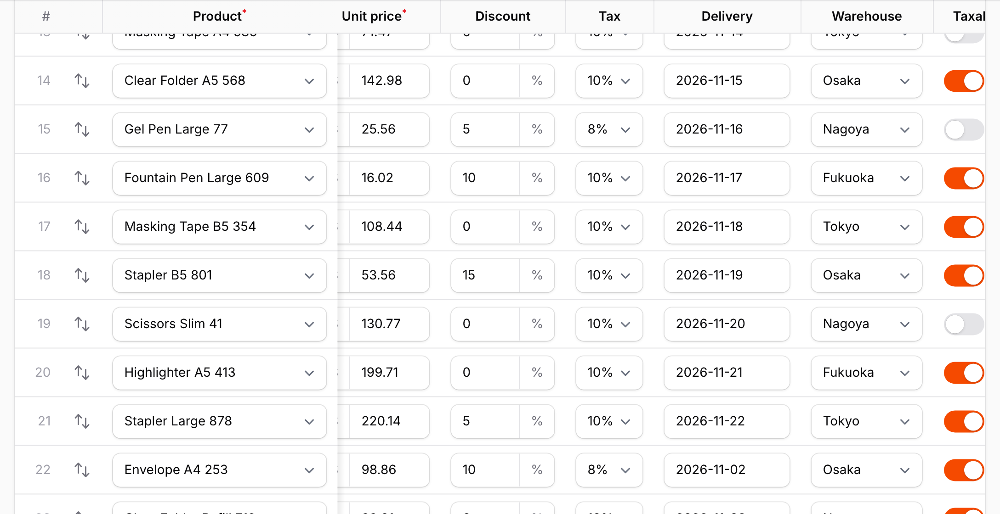

- The header row, the lines and the summary row scroll together. The column widths are computed from the content for the given width, as usual.
- `warpFrozenColumns(n)` freezes the first `n` columns of `table()`. The line numbers (`warpRowNumbers()`) and the reorder handle are always frozen with them. A thin shadow marks the edge while the table is scrolled.
- Tab and Shift+Tab move through all the fields, and the table scrolls sideways so the focused field is in view, never hidden under the frozen columns. Dropdowns and date pickers opened in a frozen column stay on top of the lines below.
- `warpStickyHeader()` keeps working: the header row follows the page while staying aligned with the scrolled columns. `warpHeight()` can be combined too.
- With multi-level rows, `n` counts the columns of the grid (`warpMultiLevel(columns: ...)`), and the fields and header cells in those columns are frozen on every line. A field or header cell that spans across the edge cannot be cut in two, so the frozen part is widened to include it: with `Product` in `warpCell(col: 1, colSpan: 2)`, `warpFrozenColumns(1)` freezes the first two grid columns.
- In narrow containers, where Filament stacks each item as a card, there is nothing to scroll and both settings are ignored.

Multi-level rows with `warpTableWidth(1600)->warpFrozenColumns(2)`, scrolled sideways: the product, delivery and gift cells stay in view on both lines.

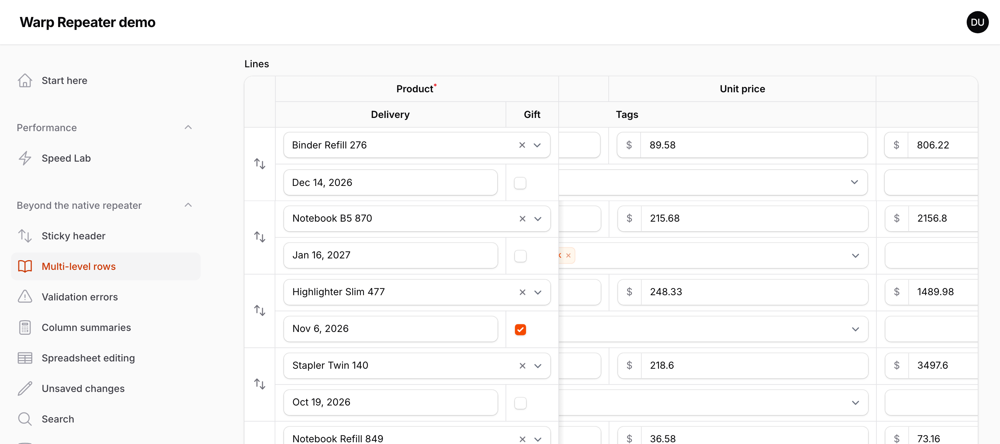

## Supported fields

Every field works, because the fields you interact with are always Filament's own. The canvas only has to draw the rows you are not interacting with:

| Field | Drawn on the canvas |
| --- | --- |
| `TextInput` | The current value (or the placeholder), prefixes and suffixes, icons, password dots, number fields with the browser's spin buttons. |
| `Select` | Native selects, searchable and JavaScript selects (the selected label, wrapped like the native one) and multiple selects (the selected badges). |
| `DatePicker`, `DateTimePicker`, `TimePicker` | Native inputs, and JavaScript pickers with the value in their display format. |
| `Toggle`, `Checkbox` | On and off states with their colors. |
| `Textarea` | The text, wrapped like the browser does, with the resize handle. |
| Anything else | The HTML that Filament renders for the field, for example placeholders and text entries, hints, helper texts and error messages. |

Values changed in the browser and not yet sent to the server are drawn from Livewire's state. The labels of searchable selects and the display format of JavaScript date pickers are computed in the browser until the next request, in the language of the picker (`zh_CN` writes "1月 16, 2027" like Filament does).

A `readOnly()` text input or textarea (an amount the form calculates, for example) gets the gray background of a disabled field and no shadow, so it does not look like a field you can type in. Its text keeps the normal color. Filament's own repeater draws it like any other input.

## Multi-tenancy

Warp Repeater works in panels with [multi-tenancy](https://filamentphp.com/docs/5.x/users/tenancy) (`->tenant(Team::class)`) without any setup. It does not query the database itself. It uses the same Filament calls as the standard repeater, so the tenant scoping of your panel applies as usual:

- **Select options** in the lines, and the labels of the selected options, come from Filament (`getOptions()`, `getOptionLabel()`, `getSearchResults()`). With `relationship()`, only the records of the current tenant are offered.
- **Pasting** a label or a key into a select (`warpSpreadsheet()`) looks the option up the same way, with the search of a searchable `relationship()` select. A label or key of another tenant is not an option, so it is skipped and the old value stays.
- **Filling down** (Ctrl/Cmd+D) copies the state as it is. When the form is saved, Filament's validation checks every select value against its options, so a value of another tenant is rejected with a validation error.
- **Lines of a `relationship()` repeater** are loaded and saved by Filament, from the record of the page.
- **`RecordPicker`** lists and adds only the records of your `query()`. Filament adds its tenant scope to models that have a resource in the panel, so `Product::query()` is scoped in that case; otherwise filter by `Filament::getTenant()` in the query yourself. Keys of other tenants sent from the browser add nothing.

Things to check in your own code:

- Filament scopes a model to the tenant only when the panel has a resource for it. If the options come from a model without a resource, or from your own `options()`, `getSearchResultsUsing()` or `modifyQueryUsing()` query, filter that query by `Filament::getTenant()` yourself.
- The same goes for `exists` and `unique` rules on fields: use Filament's `scopedExists()` and `scopedUnique()`.

Panels without tenancy work as before.

### Testing with tenancy

Warp Repeater has nothing tenant-specific to test. The lines are the form's state, so test them with Filament's form assertions, after setting the tenant like the panel does on each request:

```php
use Filament\Facades\Filament;
use Livewire\Livewire;

Filament::setCurrentPanel('app');
Filament::setTenant($teamA);
Filament::bootCurrentPanel();

$component = Livewire::test(EditOrder::class, ['record' => $order->getRouteKey()]);
$item = array_key_first($component->get('data.lines'));

$component->assertFormSet(["lines.{$item}.product_id" => $bolt->getKey()]);

// a product of another team is not an option of the select, so saving it fails validation
$component
    ->set("data.lines.{$item}.product_id", $otherTeamsProduct->getKey())
    ->call('save')
    ->assertHasFormErrors(["lines.{$item}.product_id"]);
```

The keys of the lines are the repeater's item keys (`record-{id}` for a `relationship()` repeater, UUIDs otherwise), so read them from the state as above instead of using `0`, `1`, ….

## Browser tests (JavaScript)

The lines are drawn on a canvas, so most of them have no elements in the page: a Playwright (or Cypress) test cannot find the field to click with a locator, and cannot read the values. The repeater gives tests a small JavaScript API for this on its Alpine component. It does not change between releases.

```js
const repeater = (method, argument) =>
    page.evaluate(([name, arg]) => Alpine.$data(document.querySelector('.fi-warp-rep'))[name](arg), [method, argument])

// the lines as shown, with the text of each field
const lines = await repeater('rows')
// [{ key: 'record-12', line: 1, values: { product_id: 'Desk lamp', quantity: '3', gift_wrap: 'FALSE', ... } }, ...]

// where the quantity field of the 16th line is (the page scrolls to it first)
const cell = await repeater('cellPoint', { row: 15, column: 'quantity' })
// { row: 15, key: 'record-27', column: 'quantity', x: 702, y: 488, left: 652, top: 465, width: 100, height: 46, visible: true }

await page.mouse.click(cell.x, cell.y) // the line becomes the real fields and the click lands in the quantity input
await page.keyboard.press('ControlOrMeta+A')
await page.keyboard.type('7')
await page.keyboard.press('Tab') // a live(onBlur: true) field sends the value now

// wait until the request has finished and the lines are drawn again
await repeater('whenIdle')
expect((await repeater('rows'))[15].values.amount).toBe('942.83')

await page.getByRole('button', { name: 'Save changes' }).click()
await repeater('whenIdle')
// now check the database
```

- **`cellPoint({ row, column })`** returns a promise with the position of a field on the screen. `row` is the position of the line as shown (a number, 0 is the first line; after sorting or filtering, the sorted and filtered order) or the item key (a string: `record-{id}` for a `relationship()` repeater, a UUID otherwise). `column` is the field name inside the item, as in the schema (`'quantity'`, or `'price.amount'` for a nested field). If the field is out of view, the page scrolls to it first (and the repeater itself with `warpHeight()`, and sideways with `warpTableWidth()`), so a click at `x`, `y` lands on it. `x` and `y` are the center and `left`, `top`, `width`, `height` the box, in the same viewport pixels as `getBoundingClientRect()`. Pass `scroll: false` to measure without scrolling; `visible` then tells you whether the center can be clicked (not under the sticky header, a frozen column or the edge of the screen). It returns `null` for a line that does not exist or is filtered out, and for a column that does not exist or has no state (for example a `TextEntry`). With multi-level rows it finds the field on whichever level it is.
- **`rows()`** returns the lines as shown, in the shown order, each with `key` (the item key), `line` (the line number in the saved order, as `warpRowNumbers()` shows it) and `values`: the text of each field by field name, the same text that copying the cell with Ctrl/Cmd+C gives. That is the option label for selects (labels joined with `, ` for multiple selects), `TRUE` or `FALSE` for toggles and checkboxes, the stored value for dates, and an empty string for an empty field. The values come from Livewire's state, so values typed but not yet sent are included.
- **`whenIdle()`** returns a promise that resolves when no Livewire request of the form is running (adding, deleting or moving lines, `live()` fields, a paste, saving), the fields that Alpine renders have been prepared, a search has started and the lines have been drawn again. It rejects after 10 seconds (`whenIdle({ timeout: 30000 })` to wait longer).
- After a hover or a click the line is made of the real Filament fields, in `.fi-warp-rep-live-row[data-key="..."]`, so you can also use ordinary locators inside it, for example for the delete button of that line.
- Livewire may replace the `.fi-warp-rep` element on an update, so look it up again each time, as above. With several repeaters on one page, pick one with `document.querySelectorAll('.fi-warp-rep')[n]`.

## Automatic fallback

Warp Repeater only replaces the rows. In these states the regular Filament repeater is rendered instead:

- Repeaters without a `table()` layout (the default card layout and `simple()`).
- An empty repeater. Only the "Add" button is shown, like the native repeater.
- Repeaters whose item keys are plain numbers, for example after `generateUuidUsing(false)`. Warp Repeater shares the HTML of cells between lines by replacing the item key, and a number such as `1` also appears elsewhere in that HTML. The default UUID keys and the `record-{id}` keys of `relationship()` repeaters are fine.

## Limitations

The canvas cannot do everything the DOM can. These are the known differences from the native repeater:

- **Screen readers** cannot read the rows that are drawn on the canvas. The first, the last, the hovered and the focused rows are real fields, but the others are not part of the accessibility tree. If your users rely on assistive technology, keep the native repeater for them. `->warp()` accepts a closure, so you can base it on a user preference.
- **Browser find** (Cmd/Ctrl+F) does not find the values of rows that are drawn on the canvas. Use `warpSearch()` to search every line.
- **Selecting text with the mouse across several rows** is not possible. Inside one row it works, because the row under the pointer is real.
- **Fields whose display is built in the browser** other than the ones listed above, for example rich editors, file uploads and color pickers, are drawn from the HTML that Filament renders on the server, which may look plainer than the initialized field. They become fully interactive when the pointer is over the row.

## How it works

1. **Templates instead of rows.** On every Livewire render, Filament renders every cell as usual. Cells that are identical apart from the item key become one template, so 1,000 lines usually need fewer than ten templates. Values that differ per row, such as the selected label of a searchable select, are sent separately.
2. **The browser measures Filament's own markup.** A hidden table with the same markup and CSS as the native repeater gives the column widths, the row heights and a list of boxes, texts and icons to draw. Fields that Alpine renders are initialized once, detached from Livewire, to measure their real look.
3. **Canvas drawing.** The rows on screen are drawn from those lists, with the current values from Livewire's state. Scrolling only repaints the visible part.
4. **Real fields where you work.** The row under the pointer and the focused row are built from the templates as real Filament fields, bound to the item's state, on top of the canvas. Everything you do there is Filament's own code.

## Troubleshooting

**The repeater still looks like the native one.** Check whether the repeater has a `table()` layout and at least one item. Also make sure you ran `php artisan filament:assets` after installing or updating.

**Old behavior after an update.** Run `php artisan filament:assets` again. Asset URLs include a content hash, so a hard refresh is not needed once the new files are published.

## Changelog

See [CHANGELOG.md](CHANGELOG.md).

## Support

Ask a question or report a bug at https://warpui.com/support?plugin=repeater. Do not post your license key in your question.

## License

Warp Repeater is commercial software. See [LICENSE.md](LICENSE.md) for the license terms.
